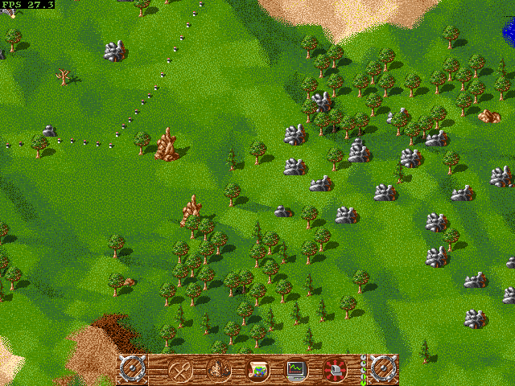

# The Settlers for the Amiga with a graphics card

**Made for an Amiga 500 / 1200 / 3000 / 4000 with a Warp accelerator** (Warp560,
Warp1240, Warp1260, Warp1260 Extreme, Warp7060). The port is developed and tested
on these cards, and the Warp's fast graphics card is what gives it the resolutions
(up to 800×600 and 960×540) and the frame rates below. Other Amigas with a
68040/68060 and a Picasso96 card run the game, but slower.
Tested on: **A1200 + Warp1260 Extreme** (68060, 100 MHz) and **A4000 + Warp7060** (68060).

The Settlers (Die Siedler, Blue Byte 1993) on an Amiga with a Picasso96 graphics
card and a 68040/68060, at up to 800×600. It is a port of
[Freeserf](https://github.com/freeserf/freeserf), the open source version of the
game (GPL-3.0), with a native Amiga backend (no SDL): an 8-bit Picasso96 screen,
Paula sound, the game's own music module and the original Amiga graphics.

**Current version: 0.120 (beta, 6.11.2026)** – the archive is
[`releases/amiga/Settlers-0.120.zip`](releases/amiga/Settlers-0.120.zip)
(the same files unpacked: [`releases/amiga/Settlers`](releases/amiga/Settlers)).



## What it has

- screens from 400×300 to 800×600 (4:3) and 640×360 / 960×540 (16:9), the map
  magnified x2 / x3
- game speed x0.5 … x3, quick save, the keys box
- a LAN game for two players on two Amigas (plus up to two computer players),
  with a chat; also over the internet with a forwarded port – played between
  Poland and Ireland (5.11.2026): the server's router forwards the TCP port
  (6810, set in the game) to its Amiga, the other player types the server's
  internet address, shown in the server box
- the options of the original: Fast building, Fast mapclick, Pathway scrolling;
  the mouse as in the original (the right button scrolls on and on, left with
  the right held opens a building or demolishes)
- in a LAN game a lobby before the start: the server chooses the map, both
  see it and chat; when the games go apart, both save and the server's game
  goes to the other side (resync), the game goes on
- the original intro of the Amiga game before the game (optional: from the
  files of your own disks 1 and 2)

## Requirements

- an Amiga with a Warp accelerator (see above), or another 68040/68060 Amiga with
  a Picasso96 card with 8-bit modes (slower)
- AmigaOS 3.x (3.2 for the mouse wheel), about 32 MB Fast RAM
- **the original The Settlers Amiga disks** – the game data is not part of this
  repository or of the archive

## Getting started

1. Unpack the archive to your hard disk, e.g. `UnZip Settlers-0.120.zip -d Work:Games`.
2. Copy from the original disks to `Settlers/data/amiga`:
   from disk 3 `gfxheader`, `gfxfast`, `gfxchip`, `sounds`, `extro`;
   from disk 2 `gfxpics`, `music`.
3. Double-click the Settlers icon.

The intro (optional): copy the files listed in `Settlers/data/intro/ReadMe.txt`
from disks 1 and 2 to `Settlers/data/intro` (`intro.script` is already there).

The same step by step, in English, Polish and German: `Settlers/doc/Install.txt` /
`Install.pdf` in the archive (all the texts of the archive are in its `doc` drawer) ([`docs/release/amiga/Install_src.txt`](docs/release/amiga/Install_src.txt)).
The full description for players, the keys and the icon settings (Tool Types):
[`docs/release/amiga/Settlers_en.txt`](docs/release/amiga/Settlers_en.txt);
the changes of each version:
[`Settlers_release_en.txt`](docs/release/amiga/Settlers_release_en.txt).

## Keys

| Key | |
|---|---|
| mouse | everything in the game, as in the original; right button + move scrolls |
| cursor keys | scroll the map |
| `+` / `-` / `0` | game speed x1.5 … x3, slower, normal (shown top right) |
| `Z`, mouse wheel | the map magnified x2 (x3 at 800×600) around the middle of the screen |
| `P` | pause (PAUSE on the screen) |
| `M` / `S` | music / sound effects on and off |
| `I` | the keys of the game (also the I button of the settings box) |
| `Ctrl`+`Z` | quick save |
| `F9` / `F10` | screenshot / game state for a bug report (in `RAM:`) |
| `Shift`+`Esc`, `Ctrl`+`Q` | quit |

## Speed (68060, Warp1260 / Warp7060)

| Scene | 640×480 | 800×600 |
|---|---|---|
| a game with many roads and serfs | ~45 fps (640×400) | ~32 fps, x2 zoom 41, x3 50 |
| the test scene | 50 fps (the limit) | 38 fps |

How it got there – terrain tiles in the card's memory copied by its blitter,
sprites as runs, paths and borders drawn into the terrain tiles, only changed
parts of a magnified view sent to the card – is described with every measurement
in [`docs/PORTING.md`](docs/PORTING.md) (Polish) and
[`docs/Settlers-raport.pdf`](docs/Settlers-raport.pdf).

## Building

The Amiga build uses bebbo's m68k-amigaos-gcc 6.5 in Docker
(`sacredbanana/amiga-compiler:m68k-amigaos`) and CMake:

```
powershell -File docker\build.ps1      ->  build/amiga/Settlers
```

Freeserf is not part of this repository: the build expects a copy in `freeserf/`
(github.com/freeserf/freeserf, commit 9b9270e) with the patches of
[`port/freeserf-patches/`](port/freeserf-patches) applied (`git am`). The Amiga
backend and the tools are in [`port/`](port), the test and measuring scripts
(AmiAgent, a remote control for the Amiga) in [`tools/`](tools). The notes for
developers: [`docs/release/amiga/Settlers_dev_en.txt`](docs/release/amiga/Settlers_dev_en.txt).

## Licence and credits

- Freeserf and this port: **GPL-3.0** ([`COPYING`](COPYING), also in the archive: `Settlers/doc/COPYING`).
- Music player [micromod](https://github.com/martincameron/micromod) by Martin
  Cameron: BSD 3-Clause.
- The Settlers © Blue Byte. The game data (graphics, sounds, music, the files of
  the intro) comes from your own original disks and is not distributed here.

---

## Po polsku

Port The Settlers (Freeserf) na Amigę z kartą graficzną Picasso96 i procesorem
68040/68060, rozdzielczości do 800×600, dźwięk przez Paulę, muzyka z oryginalnych
dyskietek. Dane gry trzeba skopiować z własnych dyskietek do `Settlers/data/amiga`
(lista plików wyżej). Opis dla graczy po polsku:
[`docs/release/amiga/Settlers.txt`](docs/release/amiga/Settlers.txt), historia wersji:
[`Settlers_release.txt`](docs/release/amiga/Settlers_release.txt), pełny opis portu
i pomiarów: [`docs/PORTING.md`](docs/PORTING.md).
